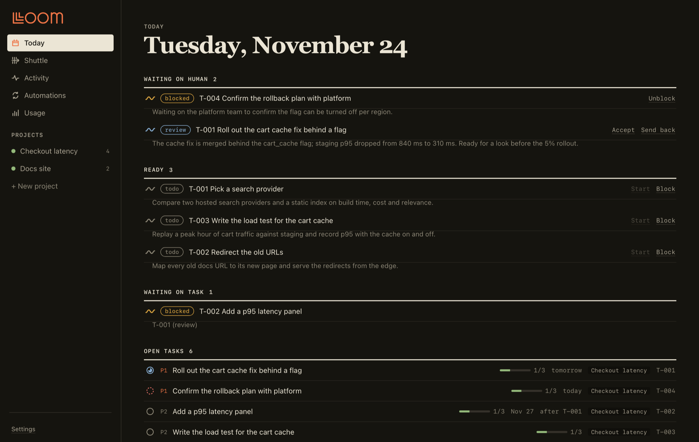
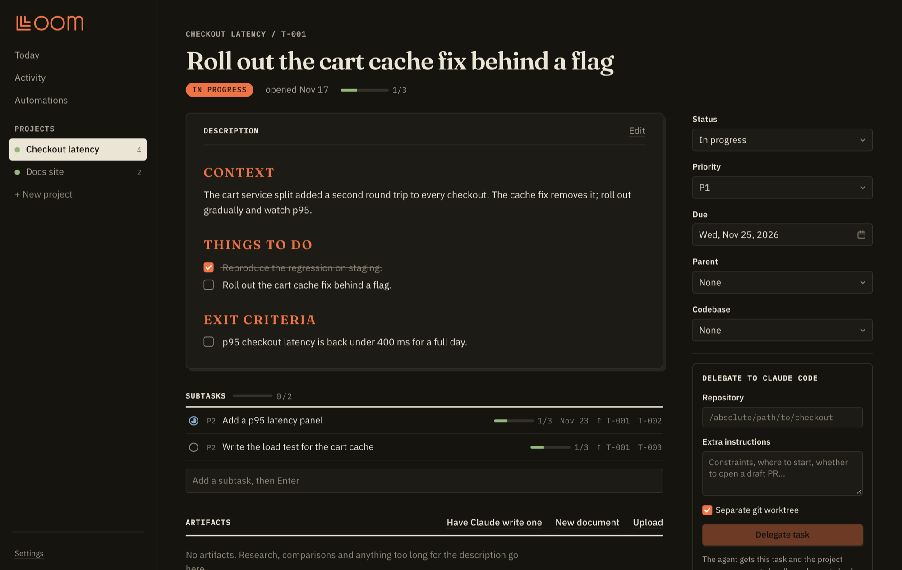

<p align="center">
  
</p>

<p align="center">
  A local project notebook kept up to date by Claude Code.
  <br>
  <a href="LICENSE"></a>
</p>



A local, single-user project notebook kept up to date by headless Claude Code sessions.
Drop in meeting notes or links; Claude files them under the right project, keeps a small
per-project memory, and pulls out your action items as tasks. Any task can be handed to a
coding agent that works in a local checkout and reports back on the task's timeline.
Automations run a shell command or a Claude prompt of your own on demand, or every day at a
time you choose.

Everything is plain markdown and JSON in one data directory, which you can also open in an
editor. There is no other database.



## Requirements

- [Bun](https://bun.sh) 1.2.3 or newer
- Git
- The [Claude Code](https://claude.com/claude-code) CLI, signed in
- Optional: read-only MCP connectors (Slack, Google Workspace, GitHub) configured in
  Claude Code, for reading private sources. Public links work through WebFetch alone.

## Run

```sh
bun install
bun start            # production, http://127.0.0.1:4400
bun run dev          # restart on change, with browser hot reload
bun run typecheck
```

| Variable | Default | |
| --- | --- | --- |
| `PORT` | `4400` | Always bound to 127.0.0.1. |
| `DASH_DATA_DIR` | `./data` | The data directory. |
| `NODE_ENV` | unset | `production` turns off development bundling and verbose errors. |

To keep it running after login on macOS: `scripts/launchd.sh install` (and `uninstall`).

There is no test suite. Verify a change against a throwaway data directory:

```sh
DASH_DATA_DIR=/tmp/dash-test PORT=4411 bun server/index.ts
```

## First use

Open Settings (bottom of the left rail) and set your name, so Claude knows which action
items are yours. The default source-reading tools assume an MCP gateway named
`gateway`; if you use other MCP servers, or none, edit "Allowed tools" and "How to
fetch sources" there, and clear "Connector gateway" to skip the one-time enable step.

## Layout

| Path | |
| --- | --- |
| `server/index.ts` | Routing, actions, the automation schedule, the file watcher |
| `server/store.ts` | Reads and writes every record |
| `server/runs.ts` | Spawns, queues, streams and resumes Claude Code sessions and automation commands |
| `server/prompts.ts` | The instructions for each kind of run |
| `server/usage.ts` | Token usage rolled up for the Usage page and `bun run usage` |
| `server/backup.ts` | Git snapshots of the data directory |
| `server/conventions.md` | The file formats; copied to `<data>/CLAUDE.md` on every start |
| `web/` | The React app (hash routes, one root state snapshot) |
| `scripts/launchd.sh` | macOS login service |
| `scripts/usage.ts` | `bun run usage [days]`: a token-usage report in markdown |
| `docs/design/` | How Loom is designed, one subject per page; start at its README |
| `docs/adr/` | Design decisions, one per file |
| `skills/loom/` | Companion skill for using Loom from any Claude Code session |

A change to a file format has to be made in `store.ts`, `conventions.md` and `prompts.ts`
together.

## Safety model

Loom is for one person on one machine. The server binds to loopback, rejects foreign `Host`
and `Origin` headers, and requires JSON for mutations; there is no authentication.
Sessions that read outside sources, Claude automations included, can edit data files but
have no shell. Coding agents get a shell in the repository you choose, in a separate git
worktree by default, and are told not to push or post. A command automation runs whatever
you wrote, with your own permissions. HTML documents render in a sandboxed frame. Deletes move to
`<data>/.trash/`, and the data directory is its own git repository that the server commits
after 30 quiet seconds.

## Off-machine backup

Snapshots stay on this disk unless the data repository has a remote. Add a private one and
the server pushes to it once a day while it is running (the rail footer shows the last
date):

```sh
git -C data remote add origin <private-repo-url>
```

Run history (`runs/`), `state.json` and `.trash/` are not in the snapshots, so they are
not pushed.

## License

[MIT](LICENSE)
